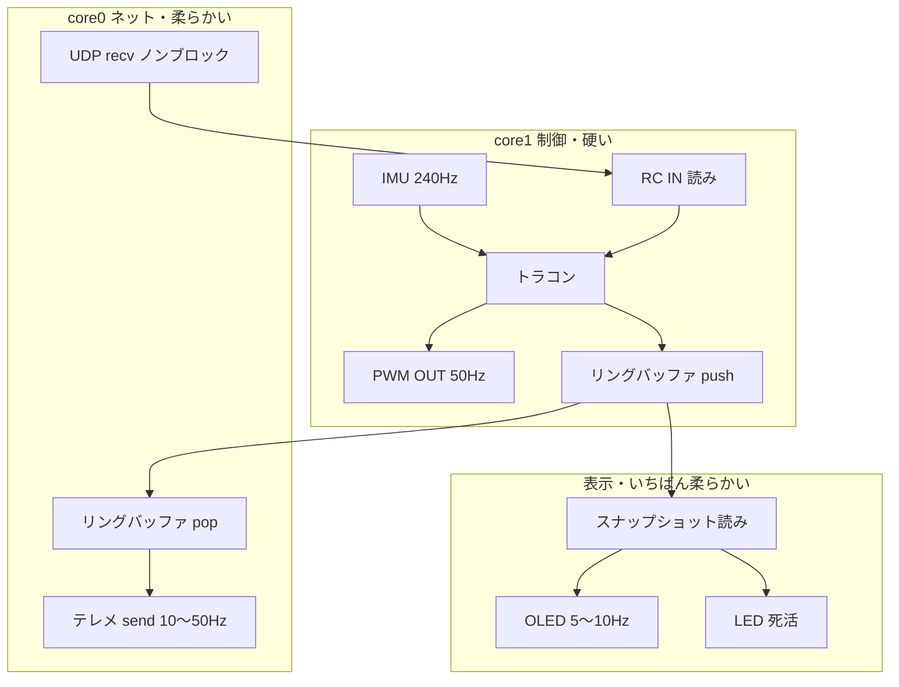

# RC トラコン向けシステム構成（案）

Pico W + MicroPython（将来 Rust + Embassy）を前提にした、タスク分割とデータの流れのメモ。

## 目的

- RC カー向け **IMU トラクションコントロール**（スロットル制限 → PWM OUT）
- **UDP** でコマンド受信・テレメトリ送信
- **OLED** で状態表示（人間向け・低優先度）
- 制御ループの **ジッタを抑える**（Wi‑Fi / 表示 / シリアル出力を制御から分離）

## ベンチで分かったこと（要約）

| 条件 | ループ周期の目安 |
|------|------------------|
| Wi‑Fi ON + LED 等 | 数 ms〜十数 ms の遅延が **数秒周期**で入る |
| Wi‑Fi OFF、空ループ | **~1 μs 未満** |
| IMU `read_imu()`（240 Hz ODR、同期読み） | **~4 ms**（正常。240 Hz ≈ 4.17 ms） |

→ **制御（センサ・PWM）と Wi‑Fi を同じループに入れない。**

## コア / タスク分割（論理構成）

物理コア 0 / 1 に近い役割分担。MicroPython では **2 つの Python VM がコアごとに動くわけではない**（`_thread` + GIL、Timer）。Rust + Embassy 移行時に **本当の core 分離**に寄せる。



### core1（制御）

| 処理 | 目安レート | 備考 |
|------|------------|------|
| IMU 読み | **240 Hz**（~4 ms/回） | `config`: accel 240 Hz。`read()` は新サンプル待ち |
| 姿勢推定 | IMU と同じ | roll / pitch（相補フィルタ、`attitude.py`）。全サンプルを順に処理する必要があるので core1 で行う |
| トラコン | IMU と同じ or 間引き | `limit` を算出 |
| RC IN | 読むだけ | **PulseIn / IRQ** でキャプチャ、メインは変数参照 |
| PWM OUT（ESC・サーボ） | **50 Hz**（20 ms） | RC パルス幅。トラコン後のスロットル |

**ここでは Wi‑Fi・OLED・`print` をしない。**

### core0（ネットワーク）

| 処理 | 目安レート | 備考 |
|------|------------|------|
| UDP **受信** | ノンブロック poll | スロットル/設定/コマンド → 共有変数（制御が読む） |
| テレメトリ **送信** | **10〜50 Hz** | リングバッファから最新スナップショットを送る |

recv / send は **同じソケット・WLAN 文脈**にまとめる（ノンブロック必須）。

### テレメトリ vs OLED の置き場所

| 機能 | 推奨 | 避ける |
|------|------|--------|
| **テレメトリ送信** | **core0**（UDP と同系） | core1（制御ループ） |
| **OLED 表示** | **低レート別タスク**（5〜10 Hz）。core0 の隙間 or 専用 `_thread` | core1 |

- **テレメ** … 走行データ。制御と同じバッファから読むが、**送信はネット側**。
- **OLED** … 人間用。I2C + `show()` は ms 級。**テレメよりさらに低優先**。同じスナップショットを読んでよい。

OLED が重い / UDP recv を遅らせたくない場合は **表示だけ別スレッド**に分離。

## データ共有（リングバッファ）

- **制御だけが書く**、テレメ・OLED は **読むだけ**（単一 writer）。
- メッセージは **固定バッファ / struct**（`dict` 毎回生成は GC 用に避ける。Rust 移行時は `#[repr(C)]` + `Channel`）。
- 深さは小さく（**1〜4**。最新優先で古いのは drop）。

```text
制御 --copy--> [ring] --copy--> テレメ
                      --copy--> OLED
UDP recv --> rc_cmd 変数 <-- 制御（読むだけ）
```

## RC 信号（参考）

| 信号 | 方向 | 実装イメージ |
|------|------|----------------|
| 受信機 → Pico | IN | パルス幅キャプチャ（HW/IRQ）。メインは `rc_throttle_us` 等を読む |
| Pico → ESC / サーボ | OUT | `machine.PWM` 50 Hz、1〜2 ms |

トラコンは **スロットル OUT** に `throttle * limit`。操舵は多くはそのまま or 別補正。

## レート早見（詳細は [hz-period-reference.md](./hz-period-reference.md)）

| Hz | 周期 (ms) | 用途例 |
|----|-----------|--------|
| 50 | 20 | RC PWM フレーム |
| 240 | ~4.17 | IMU（accel ODR） |
| 20 | 50 | テレメトリ |
| 10 | 100 | OLED |

## MicroPython 実装メモ

- **core1 相当**: メイン `while` または `machine.Timer` + IMU/PWM。`get_slp` で 1 ms ペーシングはベンチ用；本番は IMU 周期に同期。
- **core0 相当**: `_thread` または `uasyncio` で UDP + テレメ。
- **KeyboardInterrupt / `mpremote run`**: 後片付けは `try`/`finally`。Stop はソフトリブートで `except` を通らないことがある。
- **デプロイ**: `mpremote ... fs cp` に `lsm6dsv16x.py`, `vl53l1x.py` 等も含める。

## 将来（Rust + Embassy）

- core1: `imu_task` + `traction` + `pwm_task`（`embassy_time::Timer`）
- core0: `udp_rx` + `telemetry_tx`
- 表示: `oled_task`（低優先）
- 共有: `heapless` リング / `Channel<T, N>`

このドキュメントの **論理分割**をそのままタスク境界にできるようにする。

## 関連ファイル

- [hz-period-reference.md](./hz-period-reference.md) — Hz と周期の換算
- `config.py` — IMU ODR、I2C ピン
- `Devices.py` — センサ・Wi‑Fi 初期化
- `blink.py` — HW 初期化と2つのループの起動（core1 スレッド起動 → core0 で UDP ループ）
- `control_loop.py` — core1: IMU 240Hz → トラコン → PWM（ESC / サーボ）、フェイルセーフ
- `attitude.py` — roll / pitch の推定（`machine` 非依存の純粋な計算）
- `udp_loop.py` — core0: UDP 受信（ノンブロック）、Poll 応答、OLED / VSYS / LED
- `shared.py` — コア間共有状態（`array` 固定バッファ、フィールドごとに書き手は1人）
- [protocol.md](./protocol.md) — UDP コマンド形式

## 未決・後で決める

- テレメトリパケット形式（バイナリ / JSON、フィールド一覧）
- OLED を core0 に同居するか、表示専用スレッドにするか（テレメ Hz と画面内容次第）
- 走行中 Wi‑Fi を常時 ON にするか、テレメ時だけ ON にするか
