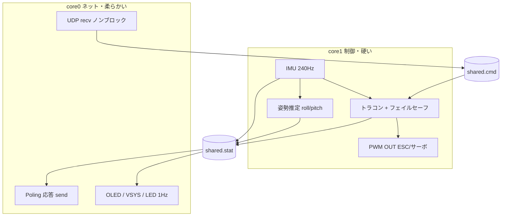

# RC トラコン向けシステム構成

Pico W + MicroPython（将来 Rust + Embassy）での、タスク分割とデータの流れのメモ。現状の実装と、未実装の構想を分けて書く。

## 目的

- RC カー向け **IMU トラクションコントロール**（スロットル制限 → PWM OUT）
- **UDP** でコマンド受信・Poling 応答（状態返信）
- **OLED** で状態表示（人間向け・低優先度）
- 制御ループの **ジッタを抑える**（Wi‑Fi / 表示 / シリアル出力を制御から分離）

## ベンチで分かったこと（要約）

| 条件 | ループ周期の目安 |
|------|------------------|
| Wi‑Fi ON + LED 等 | 数 ms〜十数 ms の遅延が **数秒周期**で入る |
| Wi‑Fi OFF、空ループ | **~1 μs 未満** |
| IMU `read_imu()`（240 Hz ODR、同期読み） | **~4 ms**（正常。240 Hz ≈ 4.17 ms） |

→ **制御（センサ・PWM）と Wi‑Fi を同じループに入れない。**

## コア / タスク分割（現状）

`blink.py` が `_thread.start_new_thread` で制御ループを **core1** に起動し、メインスレッド（**core0**）で UDP ループを回す。Python VM は 1 つで、ヒープ / GC は両コアで共有される。Rust + Embassy 移行時に、より厳密な core 分離に寄せる。



### core1（制御）`control_loop.py`

| 処理 | レート | 備考 |
|------|--------|------|
| IMU 読み | **240 Hz**（~4 ms/回） | `config`: accel / gyro 240 Hz。`read()` は新サンプル待ち。`IMU_AXIS_MAP` で車体座標に変換 |
| 姿勢推定 | IMU と同じ | roll / pitch（相補フィルタ、`attitude.py`）。全サンプルを順に処理する必要があるので core1 で行う |
| フェイルセーフ | 毎ループ | `FAILSAFE_MS` 無受信 or Emergency stop でスロットル中立・ステア中央 |
| トラコン | 毎ループ | 水平 G（\|ax\|+\|ay\|）が閾値（`level` で変化）を超えると前進スロットルを制限（最小 30%） |
| スロットル | 毎ループ | Break > 0 は即時適用。加速はスルーレート制限（accel response）、減速・TC カットは即時 |
| PWM OUT（ESC・サーボ） | PWM 周波数 **50 Hz**（20 ms） | duty は IMU ループ（240 Hz）ごとに更新 |

**ここでは Wi‑Fi・OLED・`print` をしない。** IMU が無い場合は `IMU_PERIOD_US` でペーシングする。

### core0（ネットワーク・表示）`udp_loop.py`

| 処理 | レート | 備考 |
|------|--------|------|
| UDP **受信** | ノンブロック poll（ループ末尾で `sleep_ms(1)`） | コマンド / 設定を `shared.cmd` に書く。溜まったパケットは毎回すべて処理 |
| Poling **応答** | Poling(4) 受信時のみ | `shared.stat` から 24 byte を組み立てて返信（形式は [protocol.md](./protocol.md)） |
| OLED / VSYS / 温度 / LED | **1 Hz**（`config.STATUS_INTERVAL_MS`） | VSYS が 3.6 V 未満を 3 回連続で検出したら停止 |

recv / send / 表示は **同じ core0 ループ**にまとめる（Wi‑Fi 文脈を分けない。ソケットはノンブロック必須）。

テレメトリの **定期送信（push）は未実装**。状態取得はクライアントからの Poling(4) による pull 方式。

## データ共有（`shared.py`）

- `shared.cmd`（core0 → core1）: スロットル・ステア・ブレーキ・設定値・ESTOP・最終受信時刻
- `shared.stat`（core1 → core0）: ESC / サーボ出力 us、加速度・ジャイロ、ループ周期、roll / pitch、failsafe、終了フラグ
- `shared.run`: 0 にすると両ループが停止
- 固定長 `array` のみ（毎回の `dict` 生成は GC のため避ける）。**各フィールドの書き手は 1 人**なのでロック不要（単一 int の書き込みは atomic）。
- リングバッファは使わない。読み手は常に最新値だけを見る。

```text
UDP recv --> shared.cmd  --> 制御（読むだけ）
制御     --> shared.stat --> Poling 応答 / OLED（読むだけ）
```

## 起動と停止

1. `Devices.init()`（LED・I2C・OLED・ToF・IMU・Wi‑Fi）
2. NTP 時刻同期、`shared.reset()`（failsafe 状態で開始）
3. core1 に `control_loop.run`、core0 で `udp_loop.run`
4. 停止: System Stop(5) / 低電圧 / 例外で `shared.run[0] = 0`。`blink.py` の `finally` で制御ループの終了（出力ニュートラル）を待ってから Wi‑Fi を切断
5. System Reset(6): 制御ループ停止を待って `machine.reset()`

VL53L1X（ToF）は `Devices` で初期化されるが、現状は制御ループから使っていない。

## RC 出力

| 信号 | 方向 | 実装 |
|------|------|------|
| Pico → ESC / サーボ | OUT | `machine.PWM` 50 Hz。ESC 1000〜2000 µs（中立 1500）、サーボ 1500 ± 500 µs |

トラコンは **スロットル OUT** に制限をかける。操舵は `steer + steer offset` をそのまま出力。

## レート早見（詳細は [hz-period-reference.md](./hz-period-reference.md)）

| Hz | 周期 (ms) | 用途 |
|----|-----------|------|
| 50 | 20 | RC PWM フレーム |
| 240 | ~4.17 | IMU（accel / gyro ODR）、制御ループ |
| 1 | 1000 | OLED / VSYS / LED |

## MicroPython 実装メモ

- **core1**: `_thread` で起動した `while sh.run[0]` ループ。IMU の新サンプル待ちが事実上のペーシング。
- **core0**: メインスレッドの `while` ループ（`uasyncio` は使っていない）。
- **KeyboardInterrupt / `mpremote run`**: 後片付けは `try`/`finally`。Stop はソフトリブートで `except` を通らないことがある。
- **デプロイ**: `mpremote ... fs cp` に `lsm6dsv16x.py`, `vl53l1x.py`, `ssd1306.py` 等も含める。

## 未実装・将来

- **RC 受信機入力**（パルス幅キャプチャ: PulseIn / IRQ）。現状の操作入力は UDP のみ
- **テレメトリの定期送信**（10〜50 Hz 程度）とリングバッファ化（深さ 1〜4、最新優先）
- **OLED の低レート別タスク化**（UDP recv を遅らせたくなった場合）
- Rust + Embassy 移行（この論理分割をタスク境界にする）
  - core1: `imu_task` + `traction` + `pwm_task`（`embassy_time::Timer`）
  - core0: `udp_rx` + `telemetry_tx`
  - 表示: `oled_task`（低優先）
  - 共有: `heapless` リング / `Channel<T, N>`（`#[repr(C)]`）

## 関連ファイル

- [hz-period-reference.md](./hz-period-reference.md) — Hz と周期の換算
- [protocol.md](./protocol.md) — UDP コマンド / Poling 応答の形式
- [hardware.md](./hardware.md) — 電源構成・ピン割り当て・まとめ基板の方針（サーボは TC78H653FTG 移行時に GP17 → GP18）
- [tc78h653-plan.md](./tc78h653-plan.md) — モータードライバ計画
- `config.py` — IMU ODR、I2C ピン、UDP / フェイルセーフ / PWM / 姿勢設定
- `Devices.py` — センサ・Wi‑Fi 初期化
- `blink.py` — HW 初期化と 2 つのループの起動（core1 スレッド起動 → core0 で UDP ループ）
- `control_loop.py` — core1: IMU 240 Hz → トラコン → PWM（ESC / サーボ）、フェイルセーフ
- `attitude.py` — roll / pitch の推定（`machine` 非依存の純粋な計算）
- `udp_loop.py` — core0: UDP 受信（ノンブロック）、Poling 応答、OLED / VSYS / LED
- `shared.py` — コア間共有状態（`array` 固定バッファ、フィールドごとに書き手は 1 人）
- `ssd1306.py` / `lsm6dsv16x.py` / `vl53l1x.py` — デバイスドライバ
- `imu_check.py` — IMU 動作確認
- `tools/udp_client.py` / `tools/udp_shell.py` — PC 側の UDP 操作ツール

## 未決・後で決める

- 走行中 Wi‑Fi を常時 ON にするか、必要時だけ ON にするか（現状は常時 ON）
- テレメトリを push 方式にするか（する場合のパケット形式とレート）
